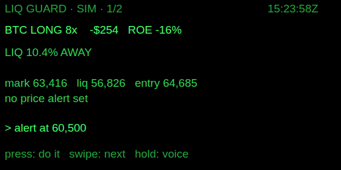
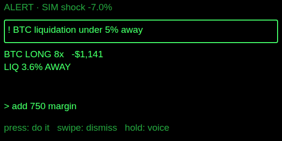
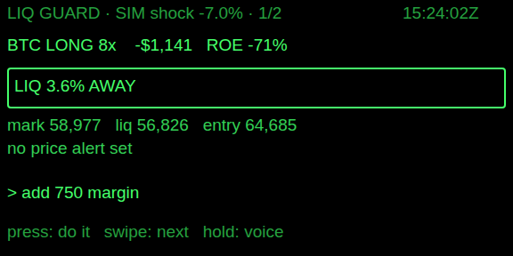
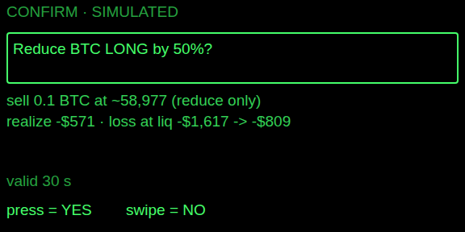
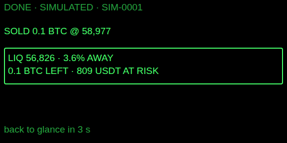
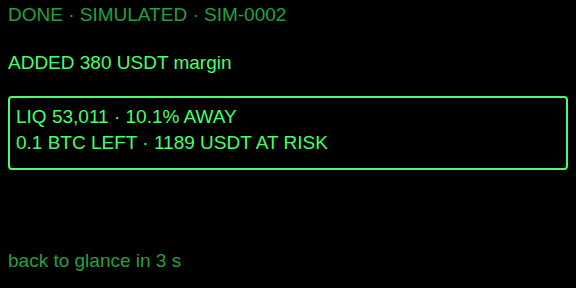

# Liq Guard

**Your leveraged futures position is sliding toward liquidation while you're away from the screen. Liq Guard puts the one number that matters, distance to liquidation, on your Even G2 glasses, and lets you fix it with one press or a short phrase.**

Track: **03 · Exchanges & Stocks** (Binance USDT-M futures). Money safety: **simulation or Binance futures testnet only**. There is no mainnet code path.

| Calm | Price drops: alert | Danger: one-press default |
|---|---|---|
|  |  |  |
| **"reduce half" → confirm card** | **press = YES** | **add margin → liq moves away** |
|  |  |  |

These are real frames of the 576 x 288 glasses canvas from the end-to-end test, drawn by our preview harness from the same container specs the SDK receives.

## What it does

- **Read at a glance.** Your worst position comes first: side, leverage, PnL, ROE and **LIQ 3.6% AWAY**. Below that: mark, liquidation and entry price, plus any armed alert. When the distance drops under 5%, the line gets a border and blinks.
- **Alerts while you trade.** Price alerts ("alert at 60k") and automatic liquidation alerts (under 10%, under 5%) open an alert screen. A move that triggers both shows only the more serious one.
- **Write with one press.** The highlighted action fits the moment:
  - **Danger:** `add 380 margin`. The amount is solved from Binance's liquidation formula so the position lands back at 10% from liquidation, capped by your wallet and by the safety caps.
  - **Calm:** set an alert halfway to liquidation. No money moves.
  - Swipe to see the other options: reduce half, close, an alert level, or your other position.
- **Write by voice.** Hold, say "reduce half", "close", "add 200 margin", "move 500 from spot to margin" or "alert at 60k", and let go. The audio goes to Whisper on our Worker, and a small regex grammar (no LLM) turns the transcript into an intent. If you'd rather type, the phone screen has a text box that follows the same path.
- **Every money action goes through one confirm card:** `Reduce BTC LONG by 50%?`, showing the exact size, price and effect. Press = YES, swipe = NO. The card expires after 30 s.

### Why "add margin" is the danger default (and not "close half")

For an **isolated** position, Binance releases margin in proportion when you reduce. So "close half" halves what you can lose at liquidation, but **the liquidation price hardly moves**. Adding margin is what moves it away. The confirm cards and result screens say this outright (`liq 56,826 -> 53,011`, `809 USDT at risk`) instead of implying that a reduce makes you safe.

## SIM and LIVE (please read)

| | SIM (default) | LIVE-TESTNET |
|---|---|---|
| Position | **simulated** isolated positions (BTC long 8x, ETH short 5x), opened relative to the current price | your Binance **futures testnet** account (`/fapi/v2/positionRisk`) |
| Prices | **live** Binance futures testnet mark prices (`/fapi/v1/premiumIndex`) | same |
| Liquidation price | computed with Binance's isolated-margin formula and maintenance brackets (snapshot) | as reported by the testnet |
| Actions | update the simulated position and wallet | real **testnet** orders: `MARKET` + `reduceOnly`, `positionMargin` |
| Label on the glasses | `SIM` in every header, `SIMULATED` on confirm/done | `BINANCE TESTNET` |

Where SIM prices come from, in order: (1) the price relay in `relay/` (a 50-line, token-gated, read-only forwarder for the public `premiumIndex` endpoint; the testnet refuses Cloudflare Worker egress, so the Worker asks the relay), (2) the testnet directly, (3) if both fail, simulated prices anchored at the last real mark, and the header then reads `SIM sim px`. A failed route is retried every 30 s, so the glasses never wait on a dead route. `/api/state` reports `priceSource` (`relay`, `testnet` or `simulated`).

SIM has one demo control: a labelled price shock (`POST /api/sim/shock`) that moves your session's simulated mark, so a demo doesn't have to wait for the market. While it is active, the header shows `SIM shock -7.0%`. Switching to LIVE is configuration only (`MODE = "LIVE"` plus three Worker secrets).

Liquidation formula (USDT-M, isolated, one-way):
`LP = (WB + cum - side*Q*EP) / (Q*MMR - side*Q)`, with WB = position margin, Q = size, EP = entry, side = +1 long / -1 short, and MMR and cum from the notional's bracket. Unit tests check it against worked examples (`test/liq.test.ts`).

## Safety and privacy

- **Testnet only.** The Binance base URL is a constant (`testnet.binancefuture.com`), and every signed call checks it.
- **No keys in the app.** The HMAC key lives only in Worker secrets. The glasses app holds a random session id and nothing else.
- **Reduce-only.** The app can only reduce, close or add margin. It can never open or increase a position, and orders carry `reduceOnly=true`.
- **Caps** (Worker vars): max order notional (25,000 USDT), max margin per action (1,000) and per day (3,000), and max actions per day.
- **Confirm token.** It is single use, bound to exactly one action, and expires after 30 s. The confirm call needs an **Idempotency-Key**, so a retried request replays the stored result instead of trading twice. A concurrent duplicate is refused.
- **Fails closed.** In LIVE mode, with no fresh price, actions are refused and the glasses show `NO LIVE PRICES · actions locked`. LIVE mode without a key never falls back to SIM, and LIVE sessions need a pairing code. In SIM nothing real can move, so when no real price route answers, the simulated position keeps running on simulated prices and the header says so (`SIM sim px`).
- **Input limits.** Bodies are capped before parsing (JSON 4 KB, audio 10 s). Audio is checked by its bytes (16 kHz mono PCM16). There are rate limits per session and per network.
- **Privacy.** Audio stays in memory, is sent once for transcription and is **never stored or logged**. The server keeps only the session's desk state (simulated positions, alerts, recent action results).

## Setup (about 10 minutes)

Needs Node 20+. The SIM mode needs no accounts and no keys.

```bash
npm install
npm test                      # 76 unit tests: liquidation math, intents, confirm flow, idempotency, screens, audio
npm run worker:dev            # local Worker on http://127.0.0.1:18787 (SIM, live testnet prices)
npm run build && npm run preview   # in a 2nd terminal: http://127.0.0.1:18573
```

Open `http://127.0.0.1:18573/preview.html?live=1` to drive the glasses screens in a browser: **Enter** = press, **Up/Down** = swipe, **Backspace** = double-press, and the text box = voice. Every screen with fixed data: `preview.html?fixture=glance-danger` (and the other names in `src/preview.ts`).

**On G2 or the Even Hub simulator:**

```bash
npx wrangler login
npm run deploy:worker                          # prints https://liq-guard.<you>.workers.dev
npm run set-api https://liq-guard.<you>.workers.dev   # writes .env.production + app.json whitelist
npm run build
npm run dev                                    # point the simulator at http://127.0.0.1:18573, or `evenhub qr` for G2
```

**LIVE on the Binance futures testnet:** create an API key on testnet.binancefuture.com, then:

```bash
npx wrangler secret put BINANCE_TESTNET_KEY    --config worker/wrangler.toml --env live
npx wrangler secret put BINANCE_TESTNET_SECRET --config worker/wrangler.toml --env live
npx wrangler secret put LIVE_PAIR_CODE         --config worker/wrangler.toml --env live
npx wrangler deploy --config worker/wrangler.toml --env live    # a separate Worker: liq-guard-live (MODE=LIVE, no demo controls)
```

**End-to-end test** (Python + Playwright): `pip install playwright && playwright install chromium`, start the Worker and the preview, then run `npm run e2e`. It walks position → price move → alert → "reduce half" → confirm → reduced → add margin, plus the API idempotency and bad-input checks, and writes `e2e/out/log.json` and screenshots.

## How it works

```
G2 glasses  <-BLE->  Even Realities App (WebView: this app, Even Hub SDK)
                         |  HTTPS, X-Session (no keys)
                         v
                 Cloudflare Worker  --  Durable Object per session (desk state, confirm tokens, idempotency)
                    |            |                         |
     Workers AI Whisper     Binance futures TESTNET     (SIM: simulated positions,
     (voice -> text)        mark prices / orders          marked to testnet prices)
```

- `shared/` holds the pure logic: `liq.ts` (formula and brackets), `intents.ts` (voice grammar), `desk.ts` (state machine: alerts, suggestions, propose/confirm, caps, SIM venue) and `screens.ts` (every glasses page as container specs, validated against the SDK rules: at most 8 text containers, exactly one `isEventCapture`).
- `worker/` holds the HTTP API, the Durable Object, the Binance testnet adapter (HMAC) and the audio checks.
- `src/` holds the glasses app: the SDK renderer (`textContainerUpgrade` for live numbers, a rebuild only when the layout changes), input mapping, the G2 mic and the controller state machine.

API: `POST /api/session`, `GET /api/state`, `POST /api/action/propose`, `POST /api/action/confirm` (Idempotency-Key), `POST /api/action/cancel`, `GET|POST /api/alerts`, `DELETE /api/alerts/:id`, `POST /api/asr`, `POST /api/intent`, and in SIM only `POST /api/sim/shock|reset`.

## What existed before Nov 23, 2026

Before the build window we had only design documents and static mockups (screen sketches and a written plan). All code in this repository was written from Nov 23, 2026 on. Third-party pieces we use as they are: the Even Hub SDK (`@evenrealities/even_hub_sdk`), Vite, TypeScript, Vitest, Wrangler / Cloudflare Workers, Workers AI Whisper, the public Binance futures testnet API, and Playwright for the end-to-end test.

## Business

Who it's for: perp traders who step away from their screens. The moment it serves: "I'm at dinner and my 8x long is sliding". Revenue path: a subscription for multi-account guarding and smarter defaults, and exchange affiliate or broker programs once it runs against real accounts with **scoped keys** that can only reduce or add margin.

## Feature requests we'd send

1. **Binance:** an API key permission that can only reduce positions and add margin (no new exposure, no withdrawals), made for wearables and watchers.
2. **Binance:** public leverage brackets without a signed call, so a simulator and a pre-trade preview can use the live table.
3. **Binance:** a user-data stream event for "liquidation distance crossed X%", so the app doesn't have to poll.
4. **Even Hub:** a minimal glance or notification while an app is closed (today a closed app can't warn you).
5. **Even Hub:** built-in speech-to-text in the SDK.

## License

MIT, see [LICENSE](LICENSE).
